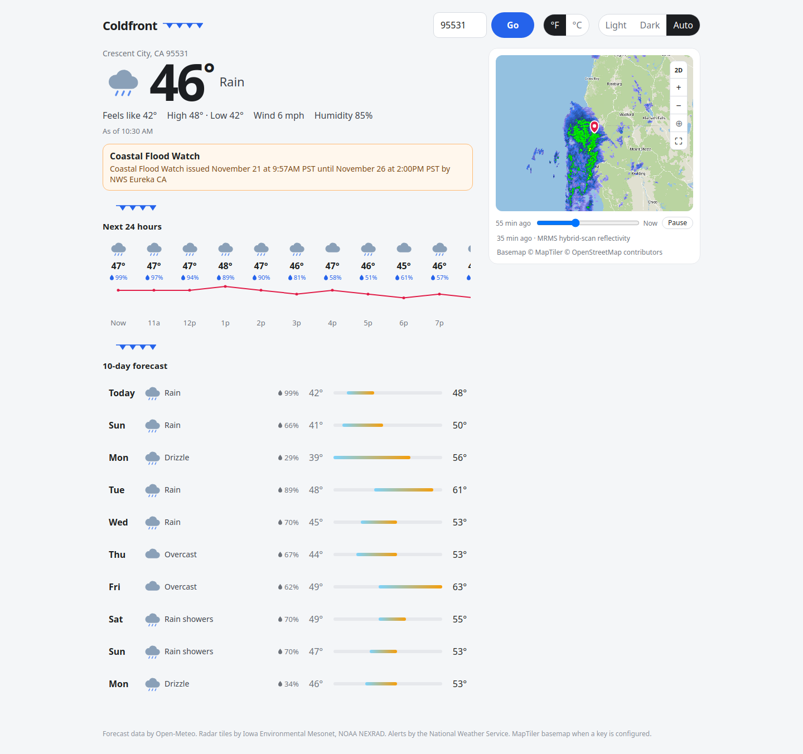
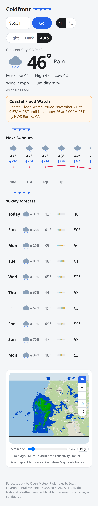
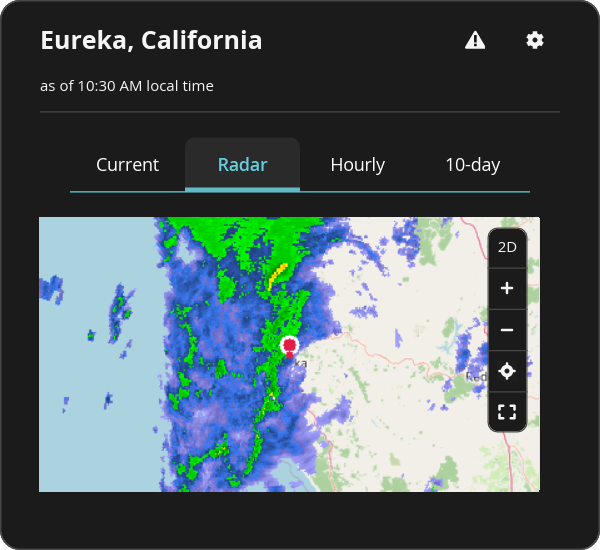
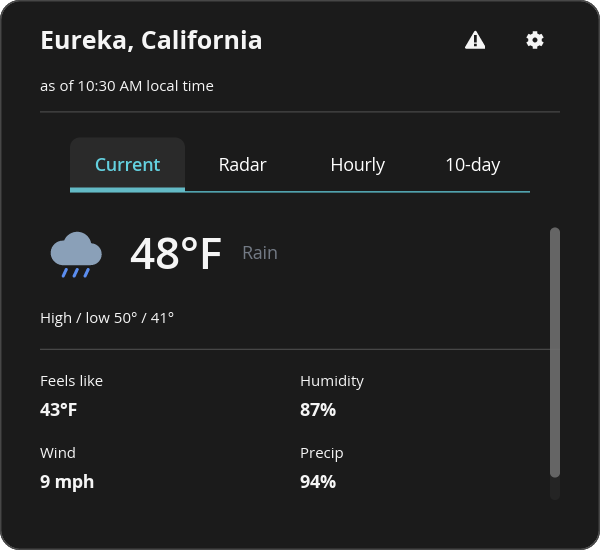
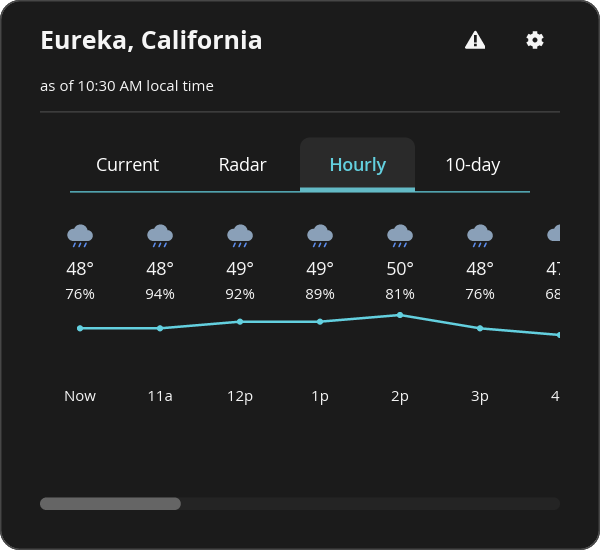
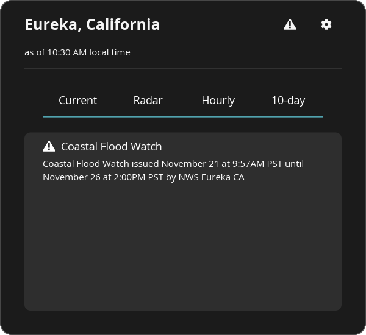

# coldfront


Coldfront shows US weather for a ZIP code or city name. The license is GPL-3.0-only.

The [web app](https://coldfront.fyi) shows current conditions, the next 24 hours, a 10-day forecast, live NEXRAD radar, and active National Weather Service alerts. The COSMIC applet shows current conditions, the radar image, and those alerts in a panel popup.

## Screenshots

Live [coldfront.fyi](https://coldfront.fyi) and COSMIC applet shots below use **Eureka, CA** (ZIP **95501**) during coastal rain and an NWS **Coastal Flood Watch**. On the web, radar is in **3D Relief** (the **2D**/**3D** toggle) with a pitched camera after tiles load.

### Web

| Desktop (1440×900) | Mobile (390×844, 2×) |
| --- | --- |
|  |  |

### COSMIC applet

Panel popup on the same ZIP — **Radar** tab with reflectivity over the coast, plus the other main tabs.



| Current | Hourly | Alerts |
| --- | --- | --- |
|  |  |  |

The two apps do not share a binary. They follow the same display rules. [Architecture](docs/architecture.md) is the design record; [reference](docs/reference.md) holds the field and route tables. [Contributing](CONTRIBUTING.md) covers local setup, tests, deploy, and release.

## Repository

```text
apps/coldfront-web      Vite + React site on a Cloudflare Worker
apps/cosmic-coldfront   COSMIC panel applet (libcosmic / iced)
crates/coldfront-core   Rust weather client, parsers, and radar math
fixtures/               JSON samples and contract.json
arch/                   Arch Linux PKGBUILD for the applet
```

## Data sources

Forecasts are requested in Celsius and km/h. The app converts them for display. Switching °F and °C does not fetch again.

| Source | Use | Credential |
| --- | --- | --- |
| [Zippopotam.us](https://api.zippopotam.us) | ZIP code to city and coordinates | none |
| [Open-Meteo geocoding](https://open-meteo.com/en/docs/geocoding-api) | US city search | none |
| [Open-Meteo](https://open-meteo.com/) | Current, hourly, and daily forecast | none |
| [api.weather.gov](https://www.weather.gov/documentation/services-web-api) | Active alerts | none; a User-Agent is required |
| [Iowa Environmental Mesonet](https://mesonet.agron.iastate.edu/GIS/ridge.phtml) | MRMS hybrid-scan reflectivity tiles | none |
| [MapTiler](https://www.maptiler.com/) | Optional street basemap | optional API key |

Every upstream request from Coldfront sends `Coldfront/0.1 (https://github.com/drmaas/coldfront)`.
