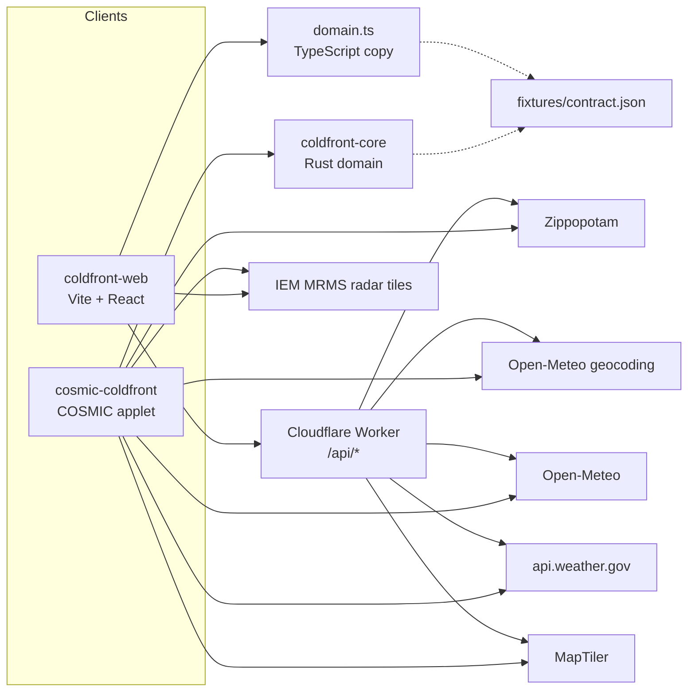
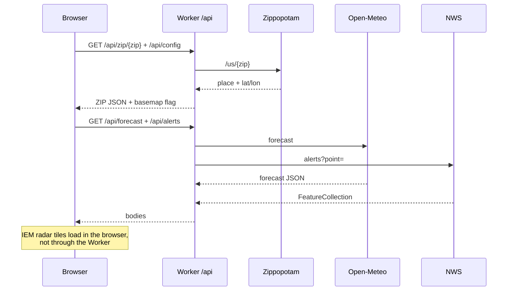
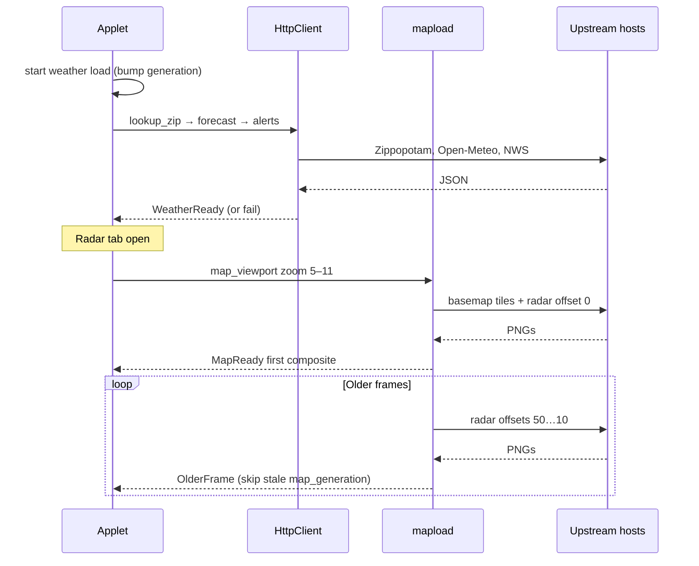
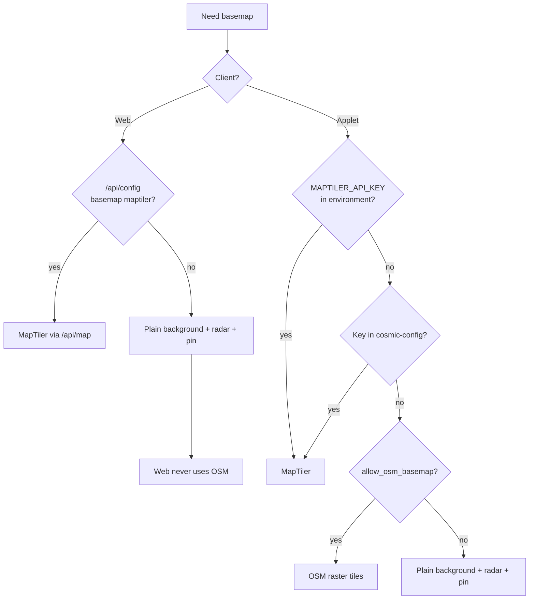

# Architecture

Design record for Coldfront. If this file and the code disagree, fix the code or update this file in the same change. Setup and release live in [CONTRIBUTING.md](../CONTRIBUTING.md). Dense tables (Open-Meteo fields, WMO codes, Worker routes, radar frames) live in [reference.md](reference.md).

Coldfront is two clients and no shared backend. A person enters a US ZIP code or city name. Five digits still resolve through Zippopotam. Anything else runs an Open-Meteo geocoding search limited to the US. Each client then loads a forecast and active alerts, and draws MRMS radar. Neither client has accounts, stores a forecast on a server, or calls the other client.

## Two clients

| Piece | Role |
| --- | --- |
| `apps/coldfront-web` | Vite/React SPA. Cloudflare Workers static assets serve the build. Worker handles `/api/*` first (`run_worker_first`). Not Pages, not Workers Sites. |
| `apps/cosmic-coldfront` | COSMIC panel applet. Links `coldfront-core`, talks to upstream hosts itself. No map widget, so it composites raster tiles into one image. |
| `crates/coldfront-core` | Rust domain crate. Web does not call it. `lib/domain.ts` is the parallel copy. |

Web page: current conditions, next 24 hours, 10-day list, radar, up to three alerts, or "No active alerts" when the list is empty. Applet popup: tabbed Current, Radar, Hourly, and 10-day views, with Settings and Alerts from the header. Up to three alerts show in the Alerts view.

## Shared rules

Change a shared rule in Rust, TypeScript, and `fixtures/contract.json` in one change. Both contract tests load the same fixtures. See [Contract lock](reference.md#contract-lock) for the full rule table.

Shared chart helpers: `chart_points` / `chartPoints`, `range_placement` / `rangePlacement`. Shared day/night icons: `display_icon` / `displayIcon`. Shared relief sample and band rules: `coldfront-core` relief module and `radarRelief.ts`. Stay in Rust: `compose_radar_map`, `compose_viewport`, `render_relief`, `HttpClient`, `symbolic_icon`.

## Data flow

Both clients request the same Open-Meteo document. Units stay metric in the model; display code converts. Query shape, parsing, and units are in [Upstream data](reference.md#upstream-data).

### Web path (short)

Routes are `/`, `/:zip`, and `/@{lat},{lon}` via `history.pushState` (no router library). A chosen city with a known ZIP still uses `/:zip`. Otherwise the coordinate path stores the place in `localStorage` under `coldfront-place` for reloads and links. Units live in `localStorage` under `coldfront-units`; changing units re-renders and does not fetch.

`loadForecast`: ZIP + config together, then forecast + alerts together. Forecast failure rejects the page. Non-OK alerts become `[]`. Alerts JSON that fails `parseAlerts` still rejects the page. Browser never sees the MapTiler key. Worker adds the NWS-required User-Agent.

Worker details, cache headers, and validation: [Worker API](reference.md#worker-api).

### Applet path (short)

App id `io.github.drmaas.CosmicColdfront`. `init` reads cosmic-config and does not fetch. After startup, a valid saved ZIP loads place, forecast, and alerts so the panel icon and temperature match. Closing the popup keeps memory; reopening does not refetch weather when `forecast` is set. Radar tiles load when the Radar tab opens.

Popup tabs are Current, Radar, Hourly, and 10-day. Settings and Alerts open from the header (not tab-bar segments). Every tab uses a fixed 480×440 popup. The popup fill is opaque. The panel button window stays transparent. Radar Full screen asks the Wayland popup to grow toward the monitor (`set_size` on the popup, not a toplevel resize) and Restore returns it to 480×440 beside the panel. Invalid ZIP bumps `generation`, clears place and forecast, and returns with no network. Alert HTTP failure becomes an empty list. A failed same-ZIP refresh keeps the last forecast. Stale `generation` / `map_generation` results are ignored.

Config version 1: `zip`, saved city coordinates (`city`, `state_abbreviation`, `latitude`, `longitude`), `fahrenheit` (default true), `maptiler_api_key`, `allow_osm_basemap` (default false). ZIP-only configs still load. Unit changes save without reload. Location changes refetch weather. Key and OSM toggle reload the map after the Radar tab has been opened.

## Radar and basemap

Both clients draw IEM MRMS hybrid-scan reflectivity tiles (`q2-hsr` / `mrms::lcref`). Web uses a 2D canvas by default (zoom 5–11, twelve frames at 750 ms). Pan and zoom transform the last settled composite; a 50 ms settle recomposites from cached, per-tile-denoised tiles without blanking the map. When WebGL2 is available, a Relief toggle rebuilds those same frames as a heightfield on a basemap (or plain) board — same pan, zoom, settle, and fullscreen as Flat; Shift-drag or right-drag orbits. The Flat radar picture is not drawn under the mesh. Missing WebGL2 leaves the toggle off. Applet Radar tab composites into a viewport that matches the map widget (about 400×220 when compact; larger when expanded), with zoom 5–11, pan/zoom gestures, offsets 50…0, and an 800 ms loop while the Radar tab is open. Pan and zoom transform the last settled composite; a 50 ms settle recomposites from cached, per-tile-denoised tiles without blanking the map. A session-only 2D / 3D control switches the same tiles into a CPU-rasterized relief heightfield in `coldfront-core` (shared sample and band rules with the web). Shift-drag or right-drag orbits; recenter restores the locked camera. Zoom, mode, and expand controls overlay the map, inset from the top-right; the frame slider stays below. `compose_radar_map` (400×260) remains for contract tests. Frame lists and layer names: [Radar](reference.md#radar).

> [!WARNING]
> OpenStreetMap public tile servers are not a fallback for a missing MapTiler key. The [OSM tile usage policy](https://operations.osmfoundation.org/policies/tiles/) asks apps not to use those tiles heavily or from distributed installs. The toggle defaults to off. Turn it on only for a personal machine. Coldfront still sends its User-Agent when the toggle is on.

## Failures

| Case | Web | Applet |
| --- | --- | --- |
| ZIP is not five digits | Inline error, no request | `Error::InvalidZip`, no request |
| Zippopotam 404 | "No place found for that ZIP code." | "no place found for that ZIP code" |
| Forecast HTTP or parse failure | Page error, no conditions | `map_error`, no new forecast |
| Alerts HTTP failure | Empty alert list, forecast still shows | Empty alert list, forecast still shows |
| Alerts body fails to parse | Page error | Empty alert list |
| MapTiler key missing | Radar on plain background | Next choice in basemap order |
| Radar tiles missing | "Radar tiles unavailable" | Caption that radar is missing |
| Stale in-flight load | AbortController on ZIP change | Drop messages with an old `generation` |

## What stays separate

- No database, accounts, or shared session.
- Web state is the URL, `localStorage` units, and memory. Applet settings are cosmic-config. Forecasts are memory only in both.
- Worker is the only web credential boundary. Applet holds an optional key in the environment or cosmic-config.
- CI runs tests and builds. On a push to `main`, the same workflow deploys the Worker after those jobs pass. Arch package builds only on a `v*` tag.
- Release version equality is the git tag, `apps/cosmic-coldfront` `version`, and `arch/PKGBUILD` `pkgver`. Core and web package versions are independent.
- Crates are `publish = false`. License is GPL-3.0-only, matching libcosmic.

## Further reading

- [reference.md](reference.md) — contract table, Open-Meteo fields, units, WMO codes, Worker routes, radar frames
- [AGENTS.md](../AGENTS.md) — change rules for agents
- Package AGENTS: [web](../apps/coldfront-web/AGENTS.md), [applet](../apps/cosmic-coldfront/AGENTS.md), [core](../crates/coldfront-core/AGENTS.md)
